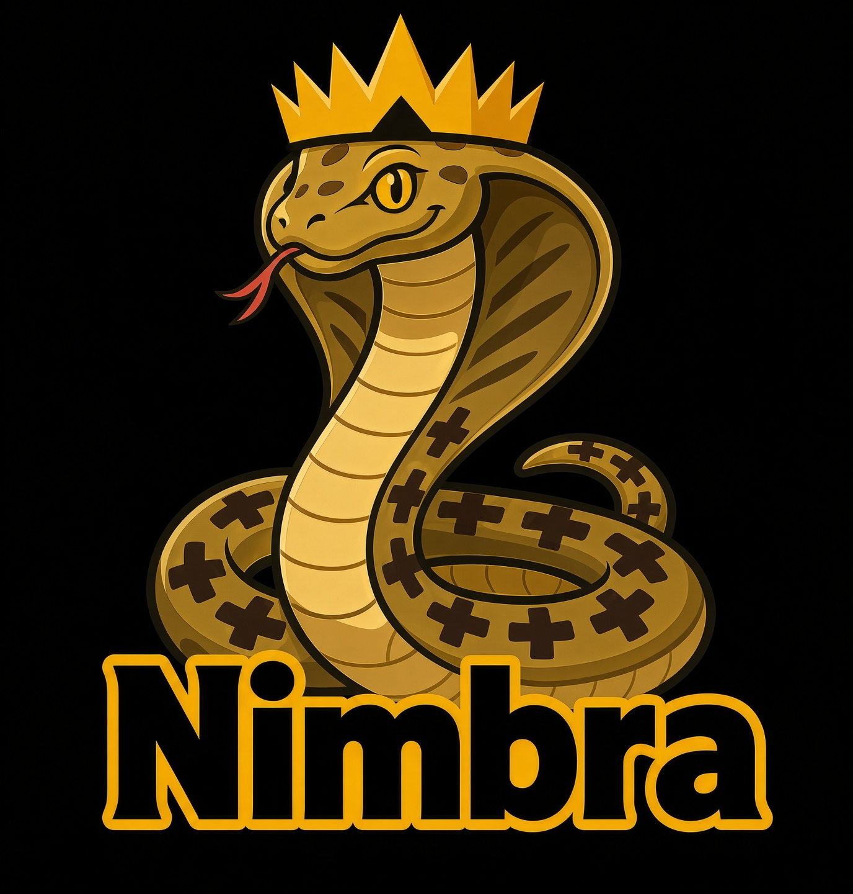

# 🌐 Language / Язык
[🇺🇸 English](#english) | [🇷🇺 Русский](#russian)

---

<a name="english"></a>
# 🇺🇸 Nimbra

A library for building CLI applications in Nim, inspired by [Cobra](https://github.com/spf13/cobra) and [Cligen](https://github.com/c-blake/cligen).

## Overview

Key features of the library:

- Simple creation of nested (hierarchical) commands.
- POSIX-compliant argument parser.
- Command aliases.
- Support for two command declaration paradigms:
  1. **Cobra-like**: Explicit command and constructor declaration.
  2. **Cligen-like**: Declarative definition via function signatures using macros.
- Lifecycle hooks similar to Cobra (`PreCommand`, `PostCommand`), with support for "inheritance" via persistent hooks *(Beta: may be unstable)*.
- Support for two error-handling paradigms:
  1. Via exceptions.
  2. Via `Result` type return values.

## Fundamental Concepts

Everything is built upon three core classes: `Command`, `Flag`, and `ArgLimit`.

- **`Command`**: The base class for a command, capable of having child subcommands.
- **`Flag`**: Represents a command-line flag. Supports aliases for long names and can be inherited (persistent).
- **`ArgLimit`**: Defines constraints on the number of positional arguments.

## Usage

The library depends on [`results`](https://github.com/arnetheduck/nim-results). With `nimble` it is installed automatically; for a plain `nim c` run `nimble install results` once. Tests: `nimble test`, examples: `nimble examples`.

### Cobra-like: explicit commands

```nim
import std/options
import nimbra

# Переменные флагов живут дольше `execute`: здесь они глобальные.
# Flag variables outlive `execute`: here they are globals.
var
  verbose = false
  port = 8080

let root = newCommand("app", help = "demo application")
root.addFlag("verbose", verbose, short = some('v'), persistent = true,
             help = "talk more")

let serve = newCommand("serve", help = "start the server", aliases = @["s"])
serve.addFlag("port", port, short = some('p'), default = some(8080),
              help = "port to listen on")
serve.argLimit = atMost(1)
serve.setRun proc(args: seq[string]) =
  echo "serving on ", port, (if verbose: " (verbose)" else: "")
root.add serve

when isMainModule:
  # Ошибка CLI: текст в stderr, код выхода 1.
  # A CLI error: message on stderr, exit code 1.
  root.executeOrQuit()
```

```
$ app -v serve -p 9000
serving on 9000 (verbose)
$ app s cfg.toml --port=1
serving on 1
$ app bogus
unknown command 'bogus' for 'app'; available: serve
```

### Cligen-like: `defineCommand`

```nim
import nimbra

proc greet(
    name {.short: 'n', help: "who to greet".}: string,
    times: int = 1,
    loud: bool,
    args: seq[string],
) {.help: "say hello".} =
  for _ in 1 .. times:
    echo (if loud: "HELLO, " else: "Hello, "), name

when isMainModule:
  # `name` без дефолта — обязательный флаг, `loud` — bool-флаг,
  # `args: seq[string]` — позиционные.
  # `name` without a default is a required flag, `loud` is a bool flag,
  # `args: seq[string]` are the positionals.
  defineCommand(greet, cmd)
  cmd.executeOrQuit()
```

```
$ greet --name Ann --times 2 --loud
HELLO, Ann
HELLO, Ann
```

### Parsing rules

- Commands come first: `app mid leaf`. Flags known to the command reached so far may stand between the command names, so a persistent root flag works before the subcommand: `app -v serve`. A local (non-persistent) parent flag is not accepted after descending.
- Command lookup stops at the first word that is not a subcommand; from there on everything that is not a flag is a positional.
- Flags of the selected command may appear anywhere: before, after and between positionals (`set pepel --dry-run`).
- Long flags: `--name value`, `--name=value`; a bool flag takes a value only with `=` (`--verbose=false`).
- Short flags: `-p 80`, `-p80`, `-p=80`, clusters `-vx`, `-vp80`; a bool takes `-v=false`.
- `--` ends flags: everything after it is positional.
- List flags (`seq[T]`) collect every mention: `--tag a --tag b`. With `sep = some(',')` (or `{.sep: ','.}` in `defineCommand`) one value is split too: `--only a,b`; empty segments are skipped.
- `--name=` gives an explicit empty string for string flags (the default is not used); for other types an empty value keeps the old meaning (default or parse error).
- `-4`, `-1.5`, `-.5`, `-1e3` are positionals unless the command has that digit as a short flag. A lone `-` is a positional.
- A command that has subcommands but no `setRun` rejects positionals with `UnknownCommandError` (word, command, available subcommands).

### Errors

- `execute` raises a `CliError` descendant and neither prints nor exits.
- `tryExecute` returns `Result[void, ref CliError]`; other exceptions are not caught.
- `executeOrQuit` prints `$err` to stderr and exits with code 1.

### Hook order

For `app mid leaf` the hooks run in this order:

1. `setPersistentPreRun` of the ancestors, root first: `app`, then `mid`. The selected command's own persistent hook does **not** run, and every ancestor's hook runs, not just the nearest one (Cobra differs on both points).
2. `setPreRun` of `leaf`.
3. `setRun` of `leaf`.
4. `setPostRun` of `leaf`.
5. `setPersistentPostRun` of the ancestors, nearest first: `mid`, then `app`.

Steps 4-5 run in a `finally`: they also run when `setRun` raises. When a pre-hook raises, neither `setRun` nor the post-hooks run.

### Flag variable lifetime

`addFlag` (and `defineCommand`) store the **address** of the variable. The variable must stay alive until the last `parse` / `execute` of the tree: use a global, or a local of the same procedure that calls `execute`. Do not build the tree in a helper procedure that returns the `Command` while the flag variables are its locals.

## Roadmap

- [ ] Add support for using asynchronous (`async`) functions as executable commands.
- [ ] Add `{.aliases.}` pragma support for aliases when using `defineCommand`.
- [ ] Add automatic generation of the `--help` flag and its content without explicit declaration.
- [ ] Add shell autocompletion support for `zsh`, `fish`, `bash`, and `pwsh`.
- [ ] Add optional autocompletion support for `nushell`.


---

## Project Structure

```
nimbra/
├── src/                    # Source code
│   ├── nimbra.nim          # Facade module: re-exports all public API
│   ├── commands/           # Core command engine
│   │   ├── command.nim     # Command tree, flag registration, argv parsing, hook execution
│   │   ├── flag.nim        # FlagSet: storage, lookup, and invocation of flags
│   │   └── arg_limits.nim  # ArgLimit type and constructors (noArgs, exact, atLeast, atMost, between)
│   ├── exceptions.nim      # CLI error hierarchy (CliError, ParsingFlagError, MissingFlagError, CliSettingError, UnknownCommandError, ArgCountError)
│   ├── stdconv.nim         # Built-in fromString parsers for CliValue concept (int, uint, float, char, string, bool, enum, IpAddress)
│   ├── pathutils.nim       # Path flag types checked at input time (FreePath, DirPath, FilePath, SymPath)
│   └── definecmd.nim       # Cligen-like macro: defineCommand macro for declarative command definition
├── tests/                  # Test suite
│   ├── all_tests.nim       # Test runner
│   ├── test_values.nim     # fromString / CliValue tests
│   ├── test_parse.nim      # argv parsing tests
│   ├── test_hooks.nim      # Hook lifecycle tests
│   ├── test_define_command.nim  # defineCommand macro tests
│   ├── test_flags.nim      # Flag registration and parsing tests
│   ├── test_pathutils.nim  # Path type tests
│   ├── test_examples.nim   # Builds and runs the examples as processes
│   ├── test_readme.nim     # Every nim block of this README must compile
│   ├── test_interspersed.nim  # Flags anywhere, command lookup, unknown command
│   └── test_list_sep.nim   # List separator, explicit empty string
├── examples/               # Example applications
│   └── simple_calc/        # Simple calculator CLI example
├── nimbra.nimble           # Nimble package manifest
└── README.md               # This file
```

### src/ — Module Reference

| File | Responsibility |
|------|----------------|
| `nimbra.nim` | **Facade**. Exports `exceptions`, `stdconv`, `arg_limits`, `command`, `definecmd`, `pathutils`. This is the single public import for users. |
| `commands/command.nim` | **Command engine**: `Command` ref object, `Parsed` result, `newCommand`, `add`, `addFlag` (3 overloads: scalar, `seq[T]`, `Option[T]`), `parse`, `execute`, `tryExecute`, `executeOrQuit`, hook setters (`setRun`, `setPreRun`, `setPostRun`, `setPersistentPreRun`, `setPersistentPostRun`), hook execution chain. |
| `commands/flag.nim` | **Flag storage**: `Flag` object, `FlagSet` with `seq[Flag]` + `byLong`/`byShort` index tables, `add`/`checkAdd`/`findLong`/`findShort`, `persistentFlags` extraction for inheritance. |
| `commands/arg_limits.nim` | **ArgLimit**: `min`/`max` bounds, constructors (`noArgs`, `exact`, `atLeast`, `atMost`, `between`), `holds` validator. |
| `exceptions.nim` | **Error hierarchy**: `CliError` (base), `ParsingFlagError` (flag + raw), `MissingFlagError` (flag), `CliSettingError` (flag), `UnknownCommandError` (word/command/available), `ArgCountError` (got/min/max), constructors, `$` formatter, `gracefulHandle`, `toCliError` for Result interop. |
| `stdconv.nim` | **Built-in parsers**: `CliValue` concept (`fromString(typedesc[T], string)`), `argHint` for help, `fromString` overloads for `int`, `uint`, `float`, `char`, `string`, `bool`, enums, `IpAddress`. |
| `pathutils.nim` | **Path flag types**: distinct `FreePath` (parent dir exists, path does not), `DirPath`, `FilePath`, `SymPath`; `fromString` resolves a relative path against the current directory and checks it once, at input time; `toPath`, `$`. |
| `definecmd.nim` | **Cligen-like macro**: `defineCommand` macro transforms a procedure signature into command construction (`newCommand` + `addFlag` + `setRun`). Supports `short`/`help` pragmas, scalar/`seq`/`Option` parameters, `Result[void, E]` return for error handling. |

> *Note for contributors: When updating this README, please keep both English and Russian versions in sync.*

---

<a name="russian"></a>
# 🇷🇺 Nimbra

Библиотека для написания CLI-приложений на Nim, вдохновленная [Cobra](https://github.com/spf13/cobra) и [Cligen](https://github.com/c-blake/cligen).

## Обзор

Основные функции библиотеки:

- Простое создание вложенных (иерархических) команд.
- POSIX-совместимый парсер аргументов.
- Псевдонимы (aliases) для команд.
- Совмещение двух способов объявления команд:
  1. **Cobra-like**: явное объявление команд и конструкторов.
  2. **Cligen-like**: декларативное описание по сигнатуре функций через макросы.
- Функции-хуки с привязкой к жизненному циклу программы на манер Cobra (`PreCommand`, `PostCommand`) с возможностью "наследования" через persistent-версии *(Бета: может быть нестабильна)*.
- Поддержка двух парадигм обработки ошибок:
  1. Через исключения.
  2. Через возвращаемое значение с типом `Result`.

## Фундаментальные концепции

Всё базируется на трех основных классах: `Command`, `Flag` и `ArgLimit`.

- **`Command`**: базовый класс команды, поддерживающий дочерние элементы в виде подкоманд.
- **`Flag`**: репрезентация флага. Поддерживает псевдонимы для длинных имен и может быть наследуемым (persistent).
- **`ArgLimit`**: ограничение количества позиционных аргументов.

## Использование

Библиотека зависит от [`results`](https://github.com/arnetheduck/nim-results). Через `nimble` он ставится сам; для голого `nim c` один раз выполните `nimble install results`. Тесты: `nimble test`, примеры: `nimble examples`.

### В стиле Cobra: явные команды

```nim
import std/options
import nimbra

# Переменные флагов живут дольше `execute`: здесь они глобальные.
# Flag variables outlive `execute`: here they are globals.
var
  verbose = false
  port = 8080

let root = newCommand("app", help = "demo application")
root.addFlag("verbose", verbose, short = some('v'), persistent = true,
             help = "talk more")

let serve = newCommand("serve", help = "start the server", aliases = @["s"])
serve.addFlag("port", port, short = some('p'), default = some(8080),
              help = "port to listen on")
serve.argLimit = atMost(1)
serve.setRun proc(args: seq[string]) =
  echo "serving on ", port, (if verbose: " (verbose)" else: "")
root.add serve

when isMainModule:
  # Ошибка CLI: текст в stderr, код выхода 1.
  # A CLI error: message on stderr, exit code 1.
  root.executeOrQuit()
```

```
$ app -v serve -p 9000
serving on 9000 (verbose)
$ app s cfg.toml --port=1
serving on 1
$ app bogus
unknown command 'bogus' for 'app'; available: serve
```

### В стиле Cligen: `defineCommand`

```nim
import nimbra

proc greet(
    name {.short: 'n', help: "who to greet".}: string,
    times: int = 1,
    loud: bool,
    args: seq[string],
) {.help: "say hello".} =
  for _ in 1 .. times:
    echo (if loud: "HELLO, " else: "Hello, "), name

when isMainModule:
  # `name` без дефолта — обязательный флаг, `loud` — bool-флаг,
  # `args: seq[string]` — позиционные.
  # `name` without a default is a required flag, `loud` is a bool flag,
  # `args: seq[string]` are the positionals.
  defineCommand(greet, cmd)
  cmd.executeOrQuit()
```

```
$ greet --name Ann --times 2 --loud
HELLO, Ann
HELLO, Ann
```

### Правила разбора

- Сначала команды: `app mid leaf`. Между именами команд могут стоять флаги, известные уже найденной команде, поэтому persistent-флаг корня работает до подкоманды: `app -v serve`. Локальный (не persistent) флаг родителя после спуска не принимается.
- Поиск команды останавливается на первом слове, которое не подкоманда; дальше всё, что не флаг, — позиционные.
- Флаги выбранной команды можно писать где угодно: до, после и между позиционными (`set pepel --dry-run`).
- Длинные флаги: `--name value`, `--name=value`; bool-флаг берёт значение только через `=` (`--verbose=false`).
- Короткие флаги: `-p 80`, `-p80`, `-p=80`, кластеры `-vx`, `-vp80`; bool принимает `-v=false`.
- `--` заканчивает флаги: всё после него — позиционные.
- Списочные флаги (`seq[T]`) собирают каждое упоминание: `--tag a --tag b`. С `sep = some(',')` (или `{.sep: ','.}` в `defineCommand`) одно значение тоже режется: `--only a,b`; пустые сегменты пропускаются.
- `--name=` у строкового флага — явная пустая строка (дефолт не подставляется); у остальных типов пустое значение работает как раньше (дефолт или ошибка разбора).
- `-4`, `-1.5`, `-.5`, `-1e3` — позиционные, если у команды нет такого короткого флага-цифры. Одиночный `-` — позиционный.
- Команда, у которой есть подкоманды, но нет `setRun`, отвергает позиционные ошибкой `UnknownCommandError` (слово, команда, доступные подкоманды).

### Ошибки

- `execute` кидает наследника `CliError`, ничего не печатает и не завершает процесс.
- `tryExecute` возвращает `Result[void, ref CliError]`; прочие исключения не перехватываются.
- `executeOrQuit` печатает `$err` в stderr и выходит с кодом 1.

### Порядок хуков

Для `app mid leaf` хуки идут так:

1. `setPersistentPreRun` предков от корня: `app`, затем `mid`. Собственный persistent-хук выбранной команды **не** вызывается, и вызываются хуки всех предков, а не только ближайшего (в Cobra иначе в обоих пунктах).
2. `setPreRun` команды `leaf`.
3. `setRun` команды `leaf`.
4. `setPostRun` команды `leaf`.
5. `setPersistentPostRun` предков от ближайшего: `mid`, затем `app`.

Шаги 4-5 выполняются в `finally`: и тогда, когда `setRun` кинул исключение. Если исключение кинул pre-хук, ни `setRun`, ни post-хуки не вызываются.

### Время жизни переменных флагов

`addFlag` (и `defineCommand`) хранят **адрес** переменной. Переменная должна жить до последнего `parse` / `execute` дерева: глобальная или локальная в той же процедуре, где вызывается `execute`. Не собирайте дерево во вспомогательной процедуре, которая возвращает `Command`, если переменные флагов — её локальные.

## Планы на будущее

- [ ] Добавить возможность использования асинхронных (`async`) функций как исполняемых команд.
- [ ] Добавить прагму `{.aliases.}` для псевдонимов при использовании `defineCommand`.
- [ ] Добавить автогенерацию флага `--help` и его содержимого без явного указания.
- [ ] Добавить поддержку автодополнения в `zsh`, `fish`, `bash` и `pwsh`.
- [ ] Добавить поддержку автодополнения в `nushell` (опционально).


---

## Структура проекта

```
nimbra/
├── src/                    # Исходный код
│   ├── nimbra.nim          # Фасадный модуль: реэкспортирует весь публичный API
│   ├── commands/           # Ядро команд
│   │   ├── command.nim     # Дерево команд, регистрация флагов, разбор argv, запуск хуков
│   │   ├── flag.nim        # FlagSet: хранение, поиск и вызов флагов
│   │   └── arg_limits.nim  # Тип ArgLimit и конструкторы (noArgs, exact, atLeast, atMost, between)
│   ├── exceptions.nim      # Иерархия ошибок CLI (CliError, ParsingFlagError, MissingFlagError, CliSettingError, UnknownCommandError, ArgCountError)
│   ├── stdconv.nim         # Встроенные парсеры fromString для концепта CliValue (int, uint, float, char, string, bool, enum, IpAddress)
│   ├── pathutils.nim       # Типы путей для флагов, проверяемые при вводе (FreePath, DirPath, FilePath, SymPath)
│   └── definecmd.nim       # Макрос в стиле cligen: defineCommand для декларативного определения команд
├── tests/                  # Набор тестов
│   ├── all_tests.nim       # Запускатель тестов
│   ├── test_values.nim     # Тесты fromString / CliValue
│   ├── test_parse.nim      # Тесты разбора argv
│   ├── test_hooks.nim      # Тесты жизненного цикла хуков
│   ├── test_define_command.nim  # Тесты макроса defineCommand
│   ├── test_flags.nim      # Тесты регистрации и разбора флагов
│   ├── test_pathutils.nim  # Тесты типов путей
│   ├── test_examples.nim   # Сборка и запуск примеров как процессов
│   ├── test_readme.nim     # Каждый nim-блок этого README обязан компилироваться
│   ├── test_interspersed.nim  # Флаги где угодно, поиск команды, неизвестная команда
│   └── test_list_sep.nim   # Разделитель списка, явная пустая строка
├── examples/               # Примеры приложений
│   └── simple_calc/        # Пример простого калькулятора CLI
├── nimbra.nimble           # Манифест пакета Nimble
└── README.md               # Этот файл
```

### src/ — Справочник модулей

| Файл | Ответственность |
|------|-----------------|
| `nimbra.nim` | **Фасад**. Экспортирует `exceptions`, `stdconv`, `arg_limits`, `command`, `definecmd`, `pathutils`. Единая публичная точка входа для пользователей. |
| `commands/command.nim` | **Движок команд**: `Command` (ref object), `Parsed`, `newCommand`, `add`, `addFlag` (3 перегрузки: скаляр, `seq[T]`, `Option[T]`), `parse`, `execute`, `tryExecute`, `executeOrQuit`, сеттеры хуков (`setRun`, `setPreRun`, `setPostRun`, `setPersistentPreRun`, `setPersistentPostRun`), цепочка выполнения хуков. |
| `commands/flag.nim` | **Хранилище флагов**: объект `Flag`, `FlagSet` с `seq[Flag]` + индексные таблицы `byLong`/`byShort`, `add`/`checkAdd`/`findLong`/`findShort`, `persistentFlags` для наследования. |
| `commands/arg_limits.nim` | **ArgLimit**: границы `min`/`max`, конструкторы (`noArgs`, `exact`, `atLeast`, `atMost`, `between`), валидатор `holds`. |
| `exceptions.nim` | **Иерархия ошибок**: `CliError` (база), `ParsingFlagError` (флаг + raw), `MissingFlagError` (флаг), `CliSettingError` (флаг), `UnknownCommandError` (word/command/available), `ArgCountError` (got/min/max), конструкторы, форматтер `$`, `gracefulHandle`, `toCliError` для работы с Result. |
| `stdconv.nim` | **Встроенные парсеры**: концепт `CliValue` (`fromString(typedesc[T], string)`), `argHint` для help, перегрузки `fromString` для `int`, `uint`, `float`, `char`, `string`, `bool`, перечисления, `IpAddress`. |
| `pathutils.nim` | **Типы путей для флагов**: distinct `FreePath` (родитель существует, сам путь — нет), `DirPath`, `FilePath`, `SymPath`; `fromString` разрешает относительный путь от текущего каталога и проверяет его один раз, при вводе; `toPath`, `$`. |
| `definecmd.nim` | **Макрос в стиле cligen**: `defineCommand` превращает сигнатуру процедуры в построение команды (`newCommand` + `addFlag` + `setRun`). Поддерживает прагмы `short`/`help`, параметры-скаляры/`seq`/`Option`, возврат `Result[void, E]` для обработки ошибок. |

> *Примечание для контрибьюторов: При обновлении этого файла, пожалуйста, синхронизируйте изменения в английской и русской версиях.*